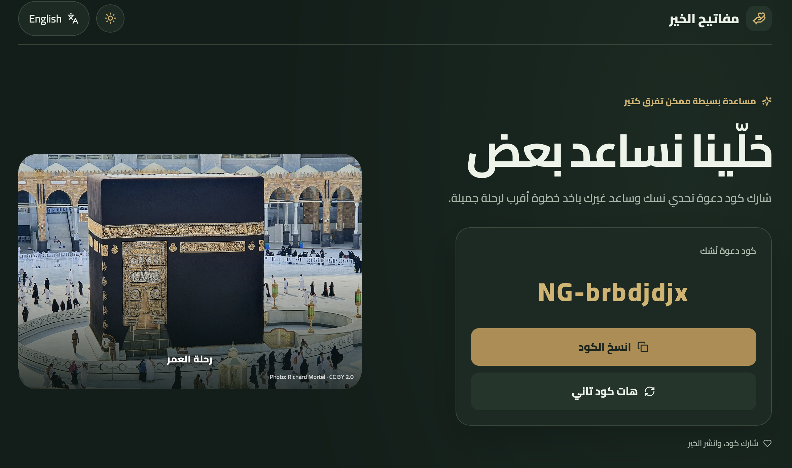
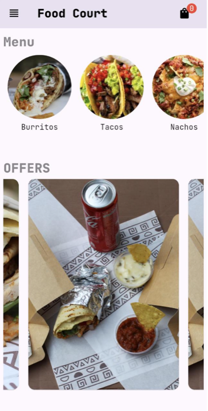
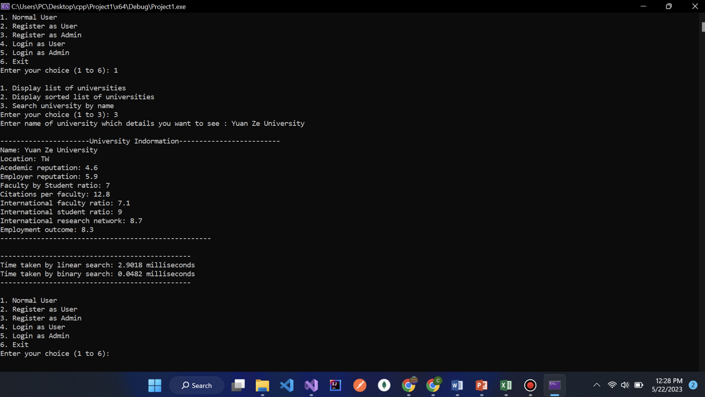

<h1 align="center">Hi, I'm Abdelrahman Mohamed 👋</h1>

<h3 align="center">Full-Stack Software Developer (.NET)</h3>

  I build scalable full-stack web applications and resilient backend services using 
  C#, ASP.NET Core (.NET), RESTful Web APIs, Entity Framework Core, Microsoft SQL Server, React.js, and Microsoft Azure.

  
  
  
  
  

  
  
  

---

## Quick Introduction

<table>
  <tr>
    <td width="33%" valign="top">
      <h3>⚙️ .NET &amp; Cloud Engineering</h3>
      
Building production RESTful Web APIs with C#, ASP.NET Core (.NET), Entity Framework Core, Microsoft SQL Server, Docker, and Microsoft Azure.

    </td>
    <td width="33%" valign="top">
      <h3>🎓 Computer Science</h3>
      
Dual-degree Bachelor of Computer Science graduate from De Montfort University, UK &amp; Asia Pacific University, Malaysia.

    </td>
    <td width="33%" valign="top">
      <h3>🏅 Certified Frontend Builder</h3>
      
Meta Front-End Developer Professional Certificate, pairing clean React.js interfaces with reliable backend systems.

    </td>
  </tr>
</table>

---

## Featured Work

<table>
  <tr>
    <td width="44%" align="center" valign="middle">
      
    </td>
    <td width="56%" valign="middle">
      <h2>🕋 Nusuk Community Platform (Live Production)</h2>
      
A live bilingual (Arabic/English) full-stack community platform for sharing and discovering verified Nusuk Challenge invitation codes.

      <ul>
        <li>ASP.NET Core RESTful Web API (.NET) containerized with Docker on Microsoft Azure</li>
        <li>Entity Framework Core + Microsoft SQL Server with transient-fault retry policies</li>
        <li>In-memory caching, IP rate limiting, and atomic duplicate-action prevention</li>
        <li>Responsive RTL/LTR React.js + Vite frontend deployed on Vercel</li>
      </ul>
      

        
        
        
        
        
      

      
<a href="https://nusukcodes.site"><strong>Live website →</strong></a> · <a href="https://portfolio-three-weld-1nl59zz6ir.vercel.app/projects/nusuk-community"><strong>Case study</strong></a>

    </td>
  </tr>
</table>

 

<table>
  <tr>
    <td width="64%" valign="middle">
      <h2>🍽️ Restaurant Canteen Ordering App</h2>
      
A cross-platform Flutter ordering application with customer and canteen manager workflows.

      <ul>
        <li>Firebase Authentication and real-time Cloud Firestore synchronization</li>
        <li>Category browsing, cart checkout, and live order tracking</li>
        <li>Location-aware checkout with Google Maps integration</li>
        <li>Structured GetX state management and reusable UI components</li>
      </ul>
      

        
        
        
        
      

      
<a href="https://portfolio-three-weld-1nl59zz6ir.vercel.app/projects/restaurant-canteen"><strong>Case study</strong></a> · <a href="https://github.com/AbdelrahmanMohamed7/restaurant-canteen-app"><strong>Source code →</strong></a>

    </td>
    <td width="36%" align="center" valign="middle">
      
    </td>
  </tr>
</table>

 

<table>
  <tr>
    <td width="42%" align="center" valign="middle">
      
    </td>
    <td width="58%" valign="middle">
      <h2>🎓 Global University Ranking Engine</h2>
      
A C++ analytics and recommendation system built around large-scale university ranking datasets.

      <ul>
        <li>Custom sorting and searching algorithm implementations</li>
        <li>Search, filtering, recommendation, and user/admin workflows</li>
        <li>File-based persistence and structured benchmark comparison</li>
      </ul>
      

        
        
        
        
      

      
<a href="https://portfolio-three-weld-1nl59zz6ir.vercel.app/projects/global-university"><strong>Case study</strong></a> · <a href="https://github.com/AbdelrahmanMohamed7/global-university-ranking-engine"><strong>Source code →</strong></a>

    </td>
  </tr>
</table>

 

<table>
  <tr>
    <td width="100%" valign="top">
      <h3>🎮 Procedural 2D Console Physics Engine</h3>
      
A C-based real-time console physics simulation featuring a configurable game loop, collision mechanics, procedural motion behavior, and ASCII playfield rendering.

      
<strong>C · 2D Physics Simulation · Real-Time Game Loop · Console Rendering</strong>

      
<a href="https://portfolio-three-weld-1nl59zz6ir.vercel.app/projects/procedural-physics"><strong>Case study</strong></a> · <a href="https://github.com/AbdelrahmanMohamed7/procedural-2D-physics-engine"><strong>Source code →</strong></a>

    </td>
  </tr>
</table>

---

## Technical Stack

<h4 align="center">Backend, Database &amp; Cloud</h4>

  

  
  
  
  
  
  

<h4 align="center">Frontend &amp; Mobile</h4>

  

<h4 align="center">Core CS &amp; Engineering Tools</h4>

  

---

  <h2>Let's connect.</h2>
  
Open to Full-Stack (.NET) and Backend Software Developer roles, remote opportunities, and product collaborations.

  

    <a href="https://mail.google.com/mail/?view=cm&amp;fs=1&amp;to=bodabanzen1818@gmail.com"><strong>Email me</strong></a>
    &nbsp;·&nbsp;
    <a href="https://portfolio-three-weld-1nl59zz6ir.vercel.app/"><strong>Visit my portfolio</strong></a>
    &nbsp;·&nbsp;
    <a href="assets/Abdelrahman_Mohamed_CV_Professional.pdf"><strong>Read my résumé</strong></a>
  

